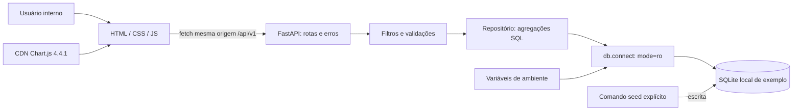
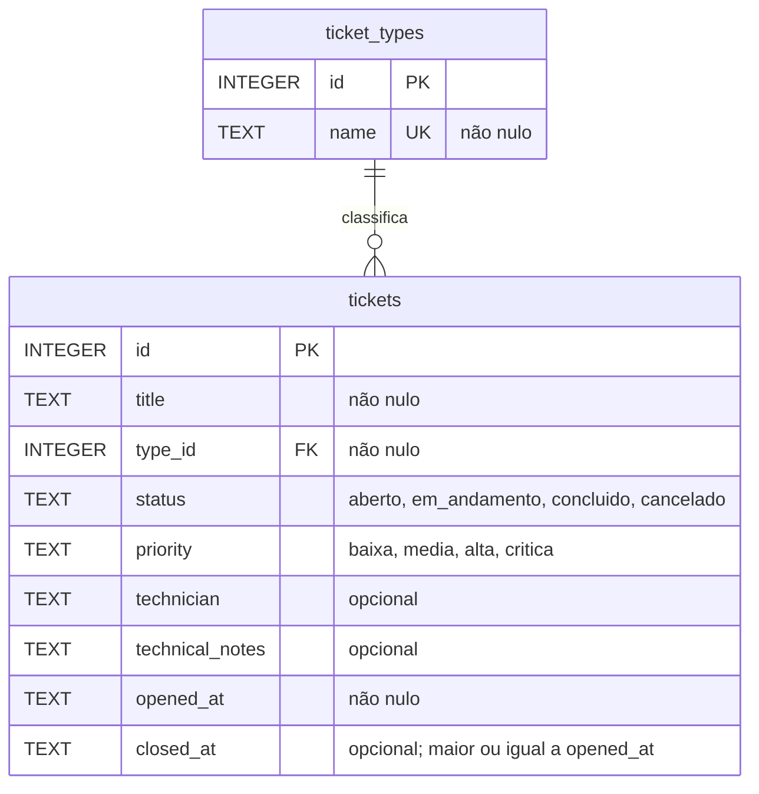

# Análise do projeto

> A análise funcional e a modelagem abaixo registram a base inicial do projeto. A arquitetura atual em Spring Boot/Thymeleaf, a integração dos recursos do ZIP e as decisões de compatibilidade estão em [MIGRACAO_SPRING.md](MIGRACAO_SPRING.md).

## Contexto e objetivo

A administração precisa acompanhar volume, situação, resolução e tipos de demanda dos chamados de suporte. A solução reúne indicadores e registros técnicos em uma única interface somente leitura. Como o ambiente Thindesk não está disponível, a entrega implementa um contrato de leitura executável sobre SQLite com dados de EXEMPLO; não simula uma integração externa já concluída.

## Requisitos funcionais e rastreabilidade

| ID | Requisito | Endpoint(s) | Componente de UI |
| --- | --- | --- | --- |
| RF01 | Indicadores de volume, situação, taxa e tempo médio | `GET /api/v1/dashboard/summary` | Sete cards; backlog também disponível na API |
| RF02 | Série de chamados abertos e atendidos por período | `GET /api/v1/dashboard/timeseries` | Linha; agrupamento por dia, semana ou mês |
| RF03 | Distribuição pelos quatro status | `GET /api/v1/dashboard/status-distribution` | Rosca com contagens e percentuais nos rótulos |
| RF04 | Ranking de tipos por volume | `GET /api/v1/dashboard/top-types` | Barras horizontais, até oito tipos |
| RF05 | Filtros comuns por período, status e tipo | `GET /api/v1/meta/filters`; filtros nos cinco endpoints de consulta | Formulário com Aplicar/Limpar; volta à página 1 |
| RF06 | Integração do dashboard com a API e detalhamento | `GET /api/v1/tickets`, `/health` e endpoints anteriores | Tabela paginada de chamados/considerações; badge da fonte |
| RF07 | Atualização e tratamento de estados | Mesmas consultas via `Promise.all`; erros padronizados | Auto 60 s; atualizado às; carregando; vazio; faixa de erro e retry |

O título “Tipos mais atendidos” segue o requisito de UI. Sua métrica conta **todos os chamados filtrados**, inclusive abertos e cancelados, como especificado para o endpoint de ranking; a legenda da interface esclarece “todos os status”. Na série temporal, atendido tem o significado estrito de concluído.

## Premissas

- **P1:** Thindesk real indisponível. SQLite local com dados de exemplo é a alternativa e é identificado como `local_sqlite`.
- **P2:** Status válidos: `aberto` (Aberto), `em_andamento` (Em andamento), `concluido` (Concluído), `cancelado` (Cancelado).
- **P3:** Atendido = concluído. A série de atendidos considera `closed_at` com `status='concluido'`; a de abertos considera `opened_at`, independentemente do status atual.
- **P4:** Nos indicadores, distribuição, ranking e lista, o período filtra `opened_at`. Na série de atendidos, filtra `closed_at`. Um chamado aberto antes do início pode ser atendido dentro do intervalo. Portanto, não se exige igualdade entre atendidos no intervalo e concluídos dos cards filtrados pela abertura.
- **P5:** Dashboard interno somente leitura. Autenticação fica fora do escopo e é pendência antes de exposição a usuários reais.

As datas são textos locais sem fuso, com segundos, no formato `YYYY-MM-DD HH:MM:SS`. A demonstração usa o relógio local (America/Sao_Paulo neste ambiente). A integração real deverá definir fuso e normalização explicitamente. Limites de datas são inclusivos; internamente o final usa `< início do próximo dia`. Semana usa `%Y-W%W` (segunda-feira, semana 00 possível), sem equivalência com semana ISO `%G-W%V`.

## Requisitos não funcionais

| ID | Requisito | Implementação e verificação |
| --- | --- | --- |
| RNF01 | Responder em menos de 500 ms com aproximadamente 10 mil chamados | Índices em abertura, fechamento e status; agregação no SQLite; banco separado com 10.000 registros e curl real, conforme [TESTES.md](TESTES.md) |
| RNF02 | Segurança | Valores parametrizados; colunas de data em lista interna permitida; leitura `file:...?mode=ro`, `uri=True`; erros internos somente no log; escape de HTML no cliente |
| RNF03 | Usabilidade | Layout responsivo, uma coluna de gráficos abaixo de 700 px; estados carregando/vazio/erro; tabela com rolagem horizontal e botões nos limites; inspeção a 600 px |
| RNF04 | Manutenibilidade | Camadas rotas → filtros → repositório → db; env consultado a cada chamada; testes com monkeypatch e banco temporário |
| RNF05 | Portabilidade | Python 3.10+, SQLite da biblioteca padrão, sem servidor de banco; Node/Chrome opcionais apenas para QA |

## Restrições

As quatro dependências diretas são exatamente FastAPI 0.115.5, Uvicorn 0.32.1, pytest 8.3.3 e httpx 0.27.2. Não há ORM, npm, dotenv, CORS ou integração externa. As dependências transitivas instaladas pelo pip estão registradas na evidência de ambiente. Chart.js 4.4.1 vem da URL CDN especificada. A documentação de `/docs` também depende dos recursos externos do Swagger UI. `.venv/`, `.db`, `.env`, caches e runtime são ignorados pelo Git.

## Decisões técnicas

| Decisão | Justificativa |
| --- | --- |
| FastAPI | Dependências reutilizáveis para filtros, validação de parâmetros, handlers centralizados e OpenAPI |
| SQLite e `sqlite3` | Execução local portátil, transações e índices sem serviço de banco; substituível por adaptador de origem |
| Dashboard servido pela API | Uma origem para HTML e JSON, caminhos relativos e ausência de configuração CORS |
| JS puro + Chart.js fixado em 4.4.1 | Atende o escopo sem build nem dependências extras; biblioteca cuida dos três tipos de gráficos |
| Agregação em SQL | Banco calcula contagens, agrupamentos e média de resolução sem transferir todos os chamados |
| Filtros imutáveis e predicados compartilhados | Mesma interpretação entre cards, ranking, distribuição e lista; parâmetro de coluna distingue abertura/encerramento |
| Erros uniformes e catch-all antes dos estáticos | Rotas desconhecidas da API retornam JSON 404; nenhum fallback HTML mascara falha de API |
| Seed explícito, fora do startup | A API não escreve nem recria o banco; a geração de exemplos exige comando separado |
| Datas relativas a `api/` | O mesmo env encontra o mesmo arquivo mesmo executando Uvicorn de outro diretório |

## Arquitetura e fluxo

O navegador consulta metadados e saúde na inicialização. Cada `load()` dispara cinco requisições em paralelo com timeout individual de 10 s. O servidor valida datas, período, status e tipos; o repositório aplica os predicados parametrizados; `db.connect` abre e fecha uma conexão por consulta. Os resultados JSON atualizam cards, gráficos e tabela. Gráficos anteriores são destruídos antes da recriação. Durante carga, o conteúdo fica esmaecido. Atualizações automáticas não se sobrepõem e usam os últimos filtros aplicados.

A API não grava dados. Dentro da listagem, contagem e página usam o mesmo snapshot. As cinco requisições HTTP são independentes: uma futura origem com ingestão concorrente pode mudar entre as respostas e exigirá avaliação de snapshot/versionamento. As medições e a verificação de consistência ocorreram sobre bancos estáticos.

## Modelagem (DER)

`PRAGMA foreign_keys=ON` é aplicado em todas as conexões; `row_factory=sqlite3.Row` facilita a conversão de respostas. O schema contém os três índices exigidos e as restrições CHECK. O schema permite `closed_at` nulo em qualquer status; o seed fornece encerramento somente para concluídos e cancelados. A média ignora nulos por semântica de `AVG`; uma origem real deverá validar a completude de encerramentos.

## Integração futura com o Thindesk real

1. Obter especificação oficial e ambiente de homologação, ou acesso de banco somente leitura autorizado. Confirmar paginação, limites, identificadores, fuso, formato e frequência das atualizações.
2. Mapear campos, status e tipos reais para o contrato local. Validar cancelamentos, reaberturas, múltiplos técnicos, fechamento e dados pessoais; testar reconciliação de totais.
3. Fornecer credenciais por variáveis de ambiente ou gerenciador de segredos. Nunca versionar tokens, senhas ou dados reais.
4. Implementar **futuramente** `api/app/sources/thindesk.py` como adaptador ou ETL incremental alimentando o mesmo schema, com checkpoints, idempotência e logs. Esse arquivo não representa uma integração existente e não foi criado como fachada de acesso real.
5. Validar contrato e desempenho contra a fonte autorizada, adicionar testes do adaptador e monitoramento de ingestão. Só então alterar a identificação da fonte.
6. Proteger o acesso com OAuth/SSO ou token atrás de proxy reverso, TLS e políticas de acesso. Avaliar distribuição local da biblioteca de gráficos em `dashboard/vendor/`.

## Pendências conhecidas

Sem integração com o Thindesk real; sem autenticação; CDN requer internet; vídeo não gravado. Publicação e situação das branches estão em [GITFLOW.md](GITFLOW.md). Evidências reais e limites das medições estão em [TESTES.md](TESTES.md).

## Referências técnicas consultadas

[Handlers de erros do FastAPI](https://fastapi.tiangolo.com/tutorial/handling-errors/) e [sqlite3 do Python](https://docs.python.org/3.14/library/sqlite3.html). As versões efetivamente executadas, os contratos locais e os resultados são descritos neste repositório.
